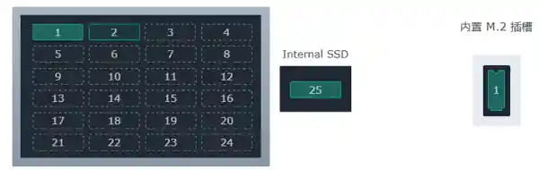

# Arc TOPLOONG StoragePanel

**Dynamic physical bay mapping, automatic hotplug recognition, drive compatibility refresh and persistent DSM StoragePanel for the TOPLOONG 4U 24-bay chassis.**

[中文](README.md) · [Installation & rollback / 安装及回滚](docs/integration-v2.md)

## Integration V2 — hardware acceptance completed on 2026-11-27

- 24 horizontal front bays (6 × 4), physical IDs 1–24, internal SATA SSD at Disk 25, native M.2 area.
- Dynamic DTS generated from SAS bay_identifier and the current ATA port.
- Bounded sysfs readiness retries (up to 15 seconds) on hotplug; live additions are allowed only when existing mappings remain unchanged.
- Delayed systemd timer reuses Arc hdddb.service and diskcompat.sh to refresh compatibility without disabling DSM's compatibility checks.
- New Arc Control option TOPLOONG_24_Bay with preview, native configuration persistence and panel regeneration on boot.
- No kernel, LKM or HBA driver modifications.

### Tested environment

TOPLOONG 4U 24-bay SAS expander, HUANANZHI X99 CH8, Xeon E5-2650 v4, LSI 9207-8i (SAS2308 IT mode), Arc 4.2.11, DSM SA6400 / epyc7002 7.4.1-90080 (Linux 5.10.55+), StorageManager 1.1.0-2018, Intel Optane 16 GB.

Cold boot correctly mapped disks 1, 2, 5 and 25. An HGST disk was added as Disk 6 via an online DTS update and udev refresh; restarting hdddb.service resolved the unverified status. After deploying Integration V2, the maintainer confirmed the final reboot and fully automatic hotplug/compatibility acceptance using a 1.5 TB disk. Raw logs for that last run were not supplied; other hardware and all 24 individual slots have not been verified.

## Installation

This is a **site-specific, version-locked hardware-tested integration**, not a universal one-click addon. The exact tested installer embeds PCIe paths, enclosure identity and an onboard SATA port. Do not bypass hash or topology checks.

Read the complete [installation and rollback guide](docs/integration-v2.md). The tested upgrade path is:

1. From the verified static DTS setup, install [Dynamic Disks V1](toploong_dynamic_install.sh).
2. In Arc Config Mode, run check then apply with [Integration V2](toploong_integration_v2.sh). V1 must already be installed, and no static DTS may remain.
3. Build Loader, boot DSM, enable the Arc Control patch service if necessary, select TOPLOONG_24_Bay and 1X1, then Apply.
4. Validate disks, existing pools and panel, then reboot and test a new noncritical disk.

Check [SHA256SUMS](SHA256SUMS). Do not reinstall V2 over a successful installation. A fresh-install path without the verified static DTS prerequisite has not been validated.

## Repository contents

The two installers and V1 source diff are in the repository root. Earlier standalone panel and static DTS files are retained for reference; see [legacy documentation](docs/legacy-static-en.md). The old DTS generator has not been independently hardware-tested.

## Safety and limitations

Back up your data and loader image/configuration. Do not install during rebuilds or recovery. Do not initialize old disks while attempting migration. Live disk relocation/removal is intentionally not handled by the add-only guard. Unrecognized boot topology may fall back to stock numbering; inspect logs and actual Disk IDs. Arc or DSM updates may overwrite patches or fail version checks. Never bypass these checks.

Thanks to [Arc Loader](https://github.com/AuxXxilium/arc), Arc Control and AuxXxilium. The installer includes modified MIT-licensed Arc scripts with original notices preserved; see [third-party notices](THIRD_PARTY_NOTICES.md). No original DSM JavaScript or full system logs are distributed. This is an independent community project.
