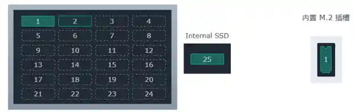

# Arc TOPLOONG StoragePanel

**拓普龙 4U 24 盘位机箱 — 动态物理盘位映射、热插拔自动识别、硬盘兼容性刷新及持久化 DSM 面板。**

[English](README.en.md) · [安装及回滚 / Installation & rollback](docs/integration-v2.md) · [技术原理](docs/dts-mapping.md)

## Integration V2 — 2026-11-27 实机验收通过

这不是单纯修改存储管理器外观的补丁。Integration V2 将 Arc disks 与 StoragePanel 两个 addon 的定制逻辑整合起来，并在 Arc Control 中增加可选面板。

- 前置 24 个横置盘位（6 行 × 4 列），编号 1–24；内部 SATA SSD 固定为 Disk 25，M.2 区域保留。
- 根据 SAS bay_identifier 和当前 ata_port_no 动态生成 DTS；无需为每次新增磁盘手工维护静态 DTS。
- 热插拔时等待 SAS 属性就绪（最长 15 秒），只允许安全新增映射，不在线改动已有槽位。
- 通过延时 systemd timer 复用 hdddb.service，更新兼容数据库及运行时状态，不关闭 DSM 硬盘兼容性检查。
- Arc Control 新增 TOPLOONG_24_Bay 及预览；选择 1X1 后保存原生配置，重启自动恢复布局。
- 不修改内核、LKM 或 HBA 驱动，不负责初始化磁盘、组装阵列或迁移存储池。

## 实机环境

| 项目 | 配置 |
| --- | --- |
| 机箱 | TOPLOONG 4U 24-bay，SAS expander |
| 主板 / CPU | HUANANZHI X99 CH8 / Xeon E5-2650 v4 |
| HBA | LSI 9207-8i，SAS2308 IT mode |
| Arc | 4.2.11 |
| DSM | SA6400 / epyc7002 / 7.4.1-90080，Linux 5.10.55+ |
| StorageManager | 1.1.0-2018 |
| M.2 | Intel Optane 16 GB |

已验证冷启动 Disk 1、2、5、25；HGST 热插拔通过在线更新和 udev 属性刷新识别为 Disk 6，手动重启 hdddb.service 后状态由未验证变为良好。随后部署 Integration V2，完成 Arc Control 选项和配置保存；项目维护者确认最后一轮重启、1.5 TB 旧盘全自动热插拔及兼容性更新验收成功。最后一轮没有附原始日志，不据此宣称所有 24 个盘位或其他硬件都已测试。

## 下载与安装

**版本及硬件限制：当前是实机验证版本，不是通用 Arc addon。** 安装包严格匹配指定版本的 Arc 源码，且物理映射包含本次测试机器的 PCIe 路径、SAS enclosure identifier 和板载 SATA 端口。其他机器即使机箱相同也可能不同。请先阅读完整[安装及回滚指南](docs/integration-v2.md)，不要绕过哈希或拓扑检查。

当前安装顺序：
1. 从已验证的静态 DTS 环境部署 [Dynamic Disks V1](toploong_dynamic_install.sh)。
2. 在 Arc Config Mode 部署 [Integration V2](toploong_integration_v2.sh)，它要求 V1 已安装且静态 DTS 已移除。
3. Build Loader → Boot DSM。在 DSM 启用 Arc Control 补丁服务（如果尚未自动启用），选择 TOPLOONG_24_Bay / 1X1 并 Apply。
4. 检查映射、存储池及面板；重启验证，最后使用无重要数据的硬盘测试热插拔。

已有本项目 V1 的用户可直接从第 2 步开始。不要再次安装已成功部署的 V2。Arc/DSM 升级可能覆盖补丁或造成版本校验失败。

## 文件

| 文件 | 用途 |
| --- | --- |
| [toploong_integration_v2.sh](toploong_integration_v2.sh) | 实机验收的集成安装脚本 |
| [toploong_dynamic_install.sh](toploong_dynamic_install.sh) | V1 安装与回滚，V2 的前置版本 |
| [toploong_dynamic_disks.patch](toploong_dynamic_disks.patch) | V1 逻辑差异补丁 |
| [SHA256SUMS](SHA256SUMS) | 发布安装文件校验 |
| [docs/integration-v2.md](docs/integration-v2.md) | 中英文部署、验证、排障和回滚 |
| [toploong_panel_test_v2.py](toploong_panel_test_v2.py) | 早期独立面板验证脚本 |
| [examples/SA6400.dts](examples/SA6400.dts) | 实机静态 DTS 示例（仅用于前置/历史方案） |
| [generate_dts.py](generate_dts.py) | 早期静态 DTS 生成工具，未单独实机验收 |
| [docs/legacy-static-zh.md](docs/legacy-static-zh.md) | 历史静态 DTS 方案说明 |

## 安全边界及致谢

不建议热拔正在使用的磁盘或在线换位。V2 在线更新只允许新增槽位；改变拓扑时应正常关机并检查重启后的映射。启动阶段未知拓扑可能回退到原生编号，不能将其视为定制映射成功。先备份数据和引导盘，不要在阵列恢复期间安装，不要初始化待迁移旧盘。严格版本检查失败时停止操作。

感谢 [Arc Loader](https://github.com/AuxXxilium/arc) / Arc Control 及 AuxXxilium。安装包内含修改后的 Arc MIT 许可脚本，保留原作者版权声明，见 [第三方许可说明](THIRD_PARTY_NOTICES.md)。不分发 DSM 原始 JavaScript 或系统日志。本项目为独立社区项目，并非 Arc 或 Synology 官方组件。
