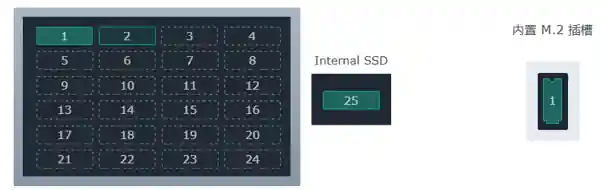

# Legacy: static DTS and standalone panel patch

> Historical documentation. See [Integration V2](../README.en.md) for the current version.

[中文](legacy-static-zh.md)

A custom physical-bay mapping and StorageManager panel for the TOPLOONG 4U 24-bay NAS chassis (24 front bays + one internal SATA SSD, plus the native M.2 area). This is an independent experimental project, not an official Arc or Synology component.



## Tested configuration

- TOPLOONG 4U, 6 rows × 4 columns, SAS expander backplane.
- HUANANZHI X99 CH8, Xeon E5-2650 v4, LSI 9207-8i (SAS2308 IT mode).
- Arc 4.2.11, SA6400 / epyc7002, DSM 7.4.1-90080, Linux 5.10.55+, StorageManager 1.1.0-2018.
- Arc StoragePanel configured as RACK_24_Bay-1X1.

Two WD Red drives appeared as Disk 1 and Disk 2; the onboard Intel S4500 appeared as Disk 25. The native M.2 Optane cache remained visible. Data and cache arrays retained their prior state, and both volumes mounted normally. The corrected V2 layout was confirmed on the actual system. The remaining front bays have not all been individually tested.

## How it works

Arc loads a custom DTS at build time. DSM uses the internal_slot@N node index as the logical Disk ID on the tested model. The panel patch reuses native StorageManager components, adding a 6×4 front section and a separate internal SSD section. No kernel, LKM or HBA driver modifications are needed.

## Installation

Back up important data, your loader image/configuration, and ensure you have a recovery path before proceeding. Do not perform the test while an array is rebuilding.

1. Inspect your actual PCIe paths, ata_port_no and SAS bay_identifier values. Follow the [DTS mapping guide](dts-mapping.md). The [example SA6400.dts](../examples/SA6400.dts) is specific to the tested machine, not a universal configuration.
2. Restart Arc into Config Mode. Upload your validated DTS via File Manager to /mnt/p3/users/SA6400.dts. Run **Build Loader**, then Boot DSM. No loader update or DSM reinstall is required. If the Custom DTS dialog waits for ZModem (rz), cancel it and use File Manager instead.
3. Verify /etc/user_model.dts, decompile /run/model.dtb, run synodisk --enum -t internal, check /proc/mdstat and mounted volumes. The test used Disk IDs 1, 2 and 25. Do not initialize or format disks if they disappear or arrays become abnormal.
4. Copy [toploong_panel_test_v2.py](../toploong_panel_test_v2.py) to DSM, e.g. /tmp/. Run as root with Python 3. On a fresh installation the expected SHA-256 of the live storage_panel.js is:

```text
678c041572871f0060c6f2da74bfc96f40d8a4c71363d2303345916c38c6edca
```

```sh
sha256sum /usr/local/packages/@appstore/StorageManager/ui/storage_panel.js
python3 /tmp/toploong_panel_test_v2.py apply && nginx -s reload
```

Stop if the original hash does not match; do not bypass the checks. The script also supports known V1/V2 installations when the original backup is available. Close Storage Manager, hard-refresh the browser, and reopen it.

## Rollback

```sh
python3 /tmp/toploong_panel_test_v2.py restore && nginx -s reload
```

Hard-refresh again. The original JS and gzip files are backed up under /root/toploong-panel-test-backup/. Do not overwrite newer package versions with an old backup.

To revert the DTS, remove the uploaded file (or restore the previous custom DTS) in Arc Config Mode, rebuild the loader and boot DSM. If storage is abnormal, restore the original configuration rather than initialize any disks.

## Limitations

- Strictly version-specific patch, with hash and replacement-anchor checks. Other package builds are not supported without further investigation.
- The DTS is static and only contains currently installed SATA drives. HBA port indices can change with discovery order or hotplug. Regenerate/verify the mapping whenever the topology changes. Dynamic mapping, hotplug relocation and SES LEDs are not implemented.
- The patch may be overwritten by Arc StoragePanel on reboot/reapply or by DSM updates; Arc Control dropdown integration and persistent frontend deployment are future work.
- Only the patch and sample configuration are distributed; no original DSM JavaScript or full system logs are included.

Thanks to [Arc Loader](https://github.com/AuxXxilium/arc), Arc Control and their developers.
