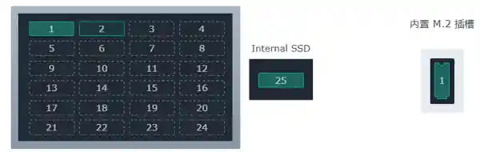

# 历史方案：静态 DTS 与独立面板补丁

> 历史文档，仅用于了解早期静态方案。当前推荐版本见 [Integration V2](../README.md)。

**拓普龙 4U 24 盘位机箱的 DSM 物理盘位映射与自定义面板（24+1 SATA / M.2）。**

[English](legacy-static-en.md)



这是一个独立的实验性补丁项目，使用 [Arc Loader](https://github.com/AuxXxilium/arc) 原生 Custom DTS 功能和 DSM 原生 StorageManager 渲染组件，不修改内核、LKM 或 HBA 驱动。

## 已实现

- 前置 24 个横置盘位，6 行 × 4 列，按从左至右、从上至下编号 1–24。
- 内置 SATA SSD 独立显示为 Disk 25，原生 M.2 区域保持不变。
- 保留原生磁盘状态颜色、空盘位及交互组件。
- 自定义 DTS 通过 Arc Build Loader 注入，已在实机上验证非连续 Disk ID（1、2、25）。
- V2 Python 面板补丁支持原始文件备份、严格 SHA-256 检查、安装、V1 升级及恢复。

## 实机验证环境

| 项目 | 配置 |
| --- | --- |
| 机箱 | TOPLOONG 4U 24-bay（6×4），SAS expander 背板 |
| 主板 / CPU | HUANANZHI X99 CH8 / Xeon E5-2650 v4 |
| HBA | LSI 9207-8i（SAS2308，IT mode） |
| Arc | 4.2.11 |
| DSM | SA6400 / epyc7002 / 7.4.1-90080，内核 5.10.55+ |
| StorageManager | 1.1.0-2018 |
| 原面板 | Arc StoragePanel RACK_24_Bay-1X1 |
| 硬盘 | 两块 WD Red 2 TB、板载 SATA Intel S4500 240 GB、Optane 16 GB M.2 |

成功启动后，红盘对应 Disk 1 / Disk 2，S4500 对应 Disk 25；数据阵列 md2、md4 和 NVMe 缓存阵列 md3 保持原状态，volume1、volume2 正常挂载。V2 对齐效果已经实际验证。其余 22 个前置盘位尚未逐一验证。

## 安装前

**此项目不是通用一键安装包。** 自定义 DTS 依赖实际 PCIe 路径、SAS Bay ID 和驱动的 ata_port_no，面板补丁则严格依赖特定 StorageManager JS 构建。备份重要数据、Arc 引导盘及配置，并保留可进入救援环境的方式。不要在存储池重建、降级恢复或重要任务进行中操作。

## 1. 配置自定义 DTS

[examples/SA6400.dts](../examples/SA6400.dts) 是本次成功启动的完整示例，**不是可直接用于所有机器的配置**。它保留本机 NVMe 和 USB 节点，只定义三块当前安装的 SATA 磁盘。

先按 [DTS 生成与验证指南](dts-mapping.md) 从自己的系统采集映射并生成 DTS。确认 PCIe 路径、端口、Bay ID、NVMe 和 USB 均正确。

1. 通过 Arc Control 的 Restart to Config Mode 进入 Arc 配置环境。
2. 使用 Arc File Manager 上传 DTS 到 `/mnt/p3/users/SA6400.dts`（本例机型为 SA6400）。
3. 执行 **Build Loader**，然后 Boot DSM；不要 Update Loader 或重新安装 DSM。
4. 在 DSM root 终端验证：

```sh
ls -l /etc/user_model.dts
dtc -I dtb -O dts /run/model.dtb 2>/dev/null | grep -A 8 'internal_slot@'
synodisk --enum -t internal
cat /proc/mdstat
df -h | grep volume
```

本例应得到 Disk 1、2、25，而 Linux 块设备名仍为 sata2、sata3、sata1。确认存储池与原状态一致后再安装面板。

如果 Custom DTS 菜单停在 `rz waiting to receive`，说明它在等待 ZModem，不是编译卡住。可以取消接收，在 File Manager 中直接上传正确命名的文件，再 Build Loader。仅在 DSM 内替换 DTB 或写入 /etc/user_model.dts 会在下次启动被引导器配置覆盖。

## 2. 安装 StoragePanel V2

下载 [toploong_panel_test_v2.py](../toploong_panel_test_v2.py)，通过 SCP 等方式传入 DSM（例如 /tmp/）。需要 Python 3 和 root 权限。先确认 Arc 原面板为 RACK_24_Bay-1X1。

```sh
P=/usr/local/packages/@appstore/StorageManager/ui
sha256sum "$P/storage_panel.js"
```

本项目已验证的原始 JS SHA-256 为：

```text
678c041572871f0060c6f2da74bfc96f40d8a4c71363d2303345916c38c6edca
```

初次安装如不匹配，请停止，不要绕过脚本检查。已安装 V1 或 V2 时，脚本会按原始备份和已知版本校验。

```sh
python3 /tmp/toploong_panel_test_v2.py apply && nginx -s reload
```

关闭 Storage Manager，浏览器强制刷新（Ctrl+F5），重新打开。应看到 6×4 盘位、独立的 Disk 25 和 M.2 插槽。

补丁只修改 storage_panel.js 和 storage_panel.js.gz，自动保存原始文件到 /root/toploong-panel-test-backup/。不分发 DSM 原始 JS，不修改 DTS、磁盘分区或存储池。

## 3. 回滚

面板恢复：

```sh
python3 /tmp/toploong_panel_test_v2.py restore && nginx -s reload
```

再次强制刷新浏览器。不要删除原始备份；如果套件已更新或校验失败，不要将旧版本 JS 强行覆盖新版本。

DTS 恢复：进入 Arc Config Mode，移走本项目导入的 SA6400.dts；如原先有自定义 DTS，恢复原始文件，再 Build Loader 并启动 DSM。若出现磁盘缺失或存储池异常，不要初始化、格式化磁盘或创建新存储池，优先恢复原引导配置。

## 已知局限

- V2 是已在实机验证的独立前端补丁，并非已经合入 Arc 的插件；重启、Arc 重新应用 StoragePanel 或 DSM/套件升级可能覆盖它。
- Arc Control 下拉列表集成尚未实现。不要在安装后再次应用其他面板而期待补丁自动保留。
- HBA 的 ata_port_no 可能随发现顺序或热插拔改变。示例 DTS 只描述目前已安装的磁盘；增加、移位或更换磁盘后，应重新验证并按实际拓扑生成映射。未实现动态映射、热插拔换位或 SES LED 控制。
- 其他 DSM 构建、机型、Arc 版本及背板未验证。不要关闭 SHA-256 安全检查。
- 本项目只关注固定安装位置和面板显示，不承诺任何数据恢复能力。

## 致谢

感谢 Arc Loader / Arc Control 项目及其开发者 AuxXxilium，以及 DSM 原生 StorageManager 的布局机制。本项目为独立社区实验，不是 Synology 或 Arc 官方组件。仓库不包含 DSM 原始前端文件或完整系统日志。
